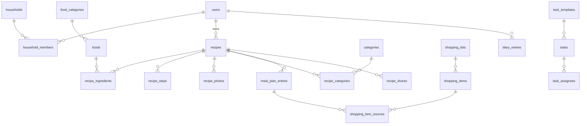

# Datový model

**Stav:** návrh k odsouhlasení (krok 0.2), 2026-08-13.
Identifikátory (tabulky, sloupce, enumy) jsou anglicky, dokumentace česky.
DB: PostgreSQL 16, rozšíření `unaccent`, `pg_trgm`, `uuid-ossp`. ORM: Drizzle.

---

## 1. Konvence platné pro celý model

### 1.1 Sync-ready sloupce

Každá **doménová (synchronizovatelná) tabulka** má:

```
id                uuid PK          -- UUIDv7 generované na klientovi
household_id      uuid FK -> households
created_at        timestamptz NOT NULL DEFAULT now()
updated_at        timestamptz NOT NULL DEFAULT now()   -- trigger na UPDATE
deleted_at        timestamptz NULL                     -- soft delete, nikdy DELETE
last_modified_by  uuid FK -> users
```

**Výjimky** (technické tabulky, nesynchronizují se, bez soft delete):
`sessions`, `password_reset_tokens`, `household_invites`, `change_log`,
`off_cache`, `backup_runs`, closure tabulky, čisté M:N vazební tabulky
(viz 1.3) a `task_completion_history` (append-only historie).

### 1.2 Change log (sync kurzor)

```
change_log(
  seq          bigserial PK,
  table_name   text NOT NULL,
  row_id       uuid NOT NULL,
  household_id uuid NOT NULL,
  op           text NOT NULL,        -- 'insert' | 'update' | 'delete'
  changed_at   timestamptz NOT NULL DEFAULT now()
)
-- index (household_id, seq)
```

Plněno **DB triggerem** na každé synchronizované tabulce (AFTER INSERT/UPDATE).
Soft delete (`deleted_at` se vyplní) se loguje jako `op='delete'`.

### 1.3 M:N vazební tabulky

Čisté vazby (`recipe_categories`, `recipe_tags`, `task_assignees`,
`recipe_step_ingredients`) mají složený PK z obou FK a **nemají** vlastní `id`
ani soft delete. Pro sync se přenášejí jako součást rodičovské entity (pole
ID v payloadu) — jednodušší než syncovat vazby po řádcích. Detail v SYNC.md.

### 1.4 Hierarchie (closure table) — viz D-005

Stromové číselníky (`categories`, `food_categories`) mají `parent_id` +
pomocnou closure tabulku:

```
<name>_closure(
  ancestor_id   uuid FK,
  descendant_id uuid FK,
  depth         int NOT NULL,        -- 0 = uzel sám
  PRIMARY KEY (ancestor_id, descendant_id)
)
```

Udržuje aplikace v jedné transakci se změnou stromu. Dotaz „vše ve skupině X
včetně podskupin" = JOIN přes `descendant_id`.

### 1.5 Vyhledávání

Prohledávané tabulky (`recipes`, `foods`, `categories`, `food_categories`,
`tags`) mají:

```
search_normalized  text GENERATED ALWAYS AS (immutable_unaccent(lower(name...))) STORED
-- GIN index gin_trgm_ops na search_normalized
```

(`immutable_unaccent` = vlastní IMMUTABLE wrapper nad `unaccent`, jinak nejde
použít v generovaném sloupci.) `recipes` navíc `search_tsv tsvector`
(konfigurace `simple`, název + úvod + poznámky) s GIN indexem.

### 1.6 Enumy

Postgres `text` + CHECK constraint (ne nativní enum — snazší rozšiřování bez
zámků na typu). Hodnoty definované v TS a Zodu jako jediný zdroj pravdy.

Jednotky (`unit`): `g | kg | ml | l | ks | lzicka | lzice | spetka | dle_chuti`.

---

## 2. Uživatelé a domácnost

```
users
  id, created_at, updated_at, deleted_at
  email            text NOT NULL UNIQUE (lower)
  password_hash    text NOT NULL            -- argon2id
  display_name     text NOT NULL
  preferences      jsonb NOT NULL DEFAULT '{}'   -- theme: light|dark|system, atd.

sessions                                     -- technická
  id               uuid PK (v4)
  token_hash       text NOT NULL UNIQUE      -- sha256 cookie tokenu
  user_id          uuid FK
  created_at, expires_at, last_used_at

password_reset_tokens                        -- technická
  id, user_id, token_hash UNIQUE, expires_at, used_at, created_at

households
  id, created_at, updated_at, deleted_at
  name             text NOT NULL

household_members
  household_id, user_id  (PK)
  role             text NOT NULL             -- 'admin' | 'member' (child později)
  joined_at        timestamptz
  UNIQUE (user_id)                           -- jedna domácnost na uživatele (D-004)

household_invites                            -- technická
  id, household_id, token_hash UNIQUE, role, invited_by, expires_at, used_at,
  created_at
```

## 3. Kuchařka

```
recipes
  [sync sloupce] , owner_id uuid FK users
  title            text NOT NULL
  intro            text                      -- úvod/popis
  base_servings    int NOT NULL
  prep_time_min    int
  cook_time_min    int
  total_time_min   int GENERATED (coalesce(prep,0)+coalesce(cook,0))
  difficulty       text                      -- 'easy' | 'medium' | 'hard'
  source           text                      -- URL nebo volný text
  notes            text
  visibility       text NOT NULL DEFAULT 'household'
                   -- 'private' | 'household' | 'shared'  (public link = tabulka)
  copied_from_recipe_id  uuid FK recipes NULL   -- „převzato od …"
  search_normalized, search_tsv

recipe_photos
  [sync], recipe_id FK
  storage_key      text NOT NULL   -- /data/uploads/<household>/<yyyy>/<mm>/<uuid>
  original_ext     text, width int, height int
  sort_order       int NOT NULL
  is_main          boolean NOT NULL DEFAULT false
  -- částečný UNIQUE (recipe_id) WHERE is_main AND deleted_at IS NULL

recipe_ingredient_groups
  [sync], recipe_id FK
  name             text NOT NULL             -- „Těsto", „Poleva"
  sort_order       int NOT NULL

recipe_ingredients
  [sync], recipe_id FK
  group_id         uuid FK groups NULL
  food_id          uuid FK foods NULL        -- NULL => volný text
  free_text        text NULL
  amount           numeric(10,3) NULL        -- NULL u 'dle_chuti'
  unit             text NULL                 -- viz 1.6
  note             text                      -- „nahrubo nasekaná"
  is_optional      boolean NOT NULL DEFAULT false
  sort_order       int NOT NULL
  nutrition_override jsonb NULL              -- {energy_kj: 1390, ...} jen pro
                                             -- tento recept, viz 5.3 zadání
  CHECK (food_id IS NOT NULL OR free_text IS NOT NULL)

recipe_steps
  [sync], recipe_id FK
  sort_order       int NOT NULL
  text             text NOT NULL
  photo_id         uuid FK recipe_photos NULL

recipe_step_ingredients                      -- vazba krok × ingredience
  step_id, ingredient_id  (PK)

categories                                   -- kategorie receptů, strom
  [sync]
  name             text NOT NULL
  parent_id        uuid FK categories NULL
  sort_order       int NOT NULL
  search_normalized
category_closure   (viz 1.4)

recipe_categories  (recipe_id, category_id PK)
tags               [sync], name, search_normalized, UNIQUE(household_id, lower(name))
recipe_tags        (recipe_id, tag_id PK)

recipe_prep_ahead
  [sync], recipe_id FK
  lead_time_hours  int NOT NULL              -- kolik hodin předem
  description      text NOT NULL             -- „upéct chléb", „namočit fazole"
```

## 4. Potraviny a výživa

```
foods
  [sync]
  name             text NOT NULL
  food_category_id uuid FK food_categories NULL
  reference_unit   text NOT NULL             -- '100g' | '100ml' | 'piece'
  -- nutriční hodnoty na referenční jednotku, vše NULLABLE (nikdy nedosazovat 0):
  energy_kj, protein_g, carbs_g, sugars_g, fiber_g, fat_g, sat_fat_g, salt_g
                   numeric(10,2) NULL
  density_g_per_ml numeric(10,4) NULL        -- převod g <-> ml
  grams_per_piece  numeric(10,2) NULL        -- převod ks <-> g
  source           text NOT NULL             -- 'seed' | 'manual' | 'openfoodfacts'
  off_barcode      text NULL
  search_normalized

food_categories                              -- strom, viz 1.4
  [sync], name, parent_id, sort_order, search_normalized
  store_section_id uuid FK store_sections NULL   -- mapování pro nákup (viz 6);
                                                 -- dědí se z nejbližšího předka
food_category_closure

food_units                                   -- „1 lžíce mouky = 12 g"
  [sync], food_id FK
  unit             text NOT NULL             -- 'lzice' | 'lzicka' | 'ks' | vlastní
  grams_per_unit   numeric(10,2) NOT NULL
  UNIQUE (food_id, unit) WHERE deleted_at IS NULL

off_cache                                    -- technická, cache Open Food Facts
  cache_key text PK (barcode nebo query), response jsonb, fetched_at
```

## 5. Jídelníček a kalendář

```
meal_types                                   -- konfigurovatelné
  [sync], name, sort_order

meal_plan_entries
  [sync]
  date             date NOT NULL
  meal_type_id     uuid FK NOT NULL
  sort_order       int NOT NULL              -- více položek v jednom slotu
  recipe_id        uuid FK recipes NULL
  free_text        text NULL                 -- „Pizza z restaurace"
  servings         numeric(5,2) NULL         -- může se lišit od base_servings
  prepared_by      uuid FK users NULL
  CHECK (recipe_id IS NOT NULL OR free_text IS NOT NULL)

prep_task_suggestions                        -- návrhy „připravit předem" (10.2)
  [sync]
  meal_plan_entry_id  uuid FK NOT NULL
  recipe_prep_ahead_id uuid FK NOT NULL
  status           text NOT NULL             -- 'suggested' | 'accepted' | 'dismissed'
  task_id          uuid FK tasks NULL        -- vyplněno při přijetí
  UNIQUE (meal_plan_entry_id, recipe_prep_ahead_id)
  -- 'dismissed' zajistí, že se návrh pro danou položku znovu nenabídne

calendar_events
  [sync]
  title            text NOT NULL
  description      text
  starts_at        timestamptz NOT NULL
  ends_at          timestamptz NULL
  all_day          boolean NOT NULL DEFAULT false
  rrule            text NULL                 -- podmnožina RFC 5545 (FREQ, INTERVAL,
                                             -- BYDAY, UNTIL, COUNT); NULL = jednorázová

calendar_event_overrides                     -- výjimky opakování
  [sync], event_id FK
  occurrence_date  date NOT NULL             -- kterou instanci mění
  is_cancelled     boolean NOT NULL DEFAULT false
  override         jsonb NULL                -- {title?, starts_at?, ends_at?}
  UNIQUE (event_id, occurrence_date)
```

Instance opakovaných událostí se **nematerializují** — počítají se při čtení
z `rrule` + overrides. (Jídelníček, úkoly a nákupy mají vlastní tabulky,
kalendář je jen skládá do jednoho pohledu.)

## 6. Nákup

```
store_sections                               -- sekce obchodu, jedno globální pořadí
  [sync], name, sort_order

shopping_lists
  [sync]
  name             text NOT NULL             -- „Nákup 10.–16. 8."
  period_start     date NOT NULL
  period_end       date NOT NULL

shopping_items                               -- samostatný záznam (neměnnost, 5.5)
  [sync], shopping_list_id FK
  food_id          uuid FK foods NULL
  free_text        text NULL
  amount           numeric(10,3) NULL
  unit             text NULL
  note             text
  store_section_id uuid FK NULL              -- snapshot při vzniku, lze změnit
  is_checked       boolean NOT NULL DEFAULT false
  checked_at       timestamptz NULL
  checked_by       uuid FK users NULL
  sort_order       int NOT NULL
  CHECK (food_id IS NOT NULL OR free_text IS NOT NULL)

shopping_item_sources                        -- odkud položka vznikla (slučování)
  [sync], shopping_item_id FK
  recipe_id        uuid FK NULL
  meal_plan_entry_id uuid FK NULL
  amount           numeric(10,3) NULL        -- původní příspěvek zdroje
  unit             text NULL
```

Sloučení = jedna `shopping_items` řádka s více `shopping_item_sources`.
Slučuje se podle `food_id` a jen při jednoznačném převodu jednotek (6.5).

## 7. Úkoly a úklid

```
task_lists                                   -- Úklid, Opravy, Zahrada, vlastní…
  [sync], name, sort_order

template_groups                              -- „Denní úklid", „Velký úklid"…
  [sync], task_list_id FK, name, sort_order

task_templates
  [sync], task_list_id FK, template_group_id FK NULL
  name, description
  interval_days    int NULL                  -- NULL = neopakuje se; 1/7/14/30/90/…
                                             -- i vlastní hodnota

tasks                                        -- samostatný záznam (neměnnost)
  [sync], task_list_id FK
  template_id      uuid FK task_templates NULL
  name             text NOT NULL             -- kopie ze šablony v okamžiku vzniku
  description      text
  period_start     date NULL                 -- úkol „někdy v týdnu"
  period_end       date NULL
  due_at           timestamptz NULL          -- volitelný konkrétní termín
  status           text NOT NULL DEFAULT 'open'   -- 'open' | 'done'
  completed_at     timestamptz NULL
  completed_by     uuid FK users NULL        -- kdo skutečně splnil (i cizí úkol)

task_assignees   (task_id, user_id PK)       -- úkol existuje jen jednou

task_completion_history                      -- append-only, pro návrhy občasných
  id, household_id, template_id FK, task_id FK, completed_at, completed_by
```

Návrh „je čas znovu": poslední `task_completion_history.completed_at` pro
šablonu + `interval_days` < dnes → kandidát. Rozprostření zátěže mezi týdny
navrhnu v rámci Fáze 6 (algoritmus, ne schéma).

## 8. Výživový deník

```
diary_entries                                -- PER UŽIVATEL, nezávislé na jídelníčku
  [sync], user_id FK NOT NULL
  date             date NOT NULL
  meal_type_id     uuid FK NULL
  source_kind      text NOT NULL             -- 'recipe' | 'food' | 'manual'
  recipe_id        uuid FK NULL              -- jen reference „odkud", ne zdroj čísel
  food_id          uuid FK NULL
  title            text NOT NULL             -- snapshot názvu
  amount           numeric(10,3) NULL        -- snědené množství / porce
  unit             text NULL                 -- 'porce' | g | ml | ks …
  nutrition        jsonb NOT NULL            -- SNAPSHOT vypočtených hodnot:
                                             -- {energy_kj: …, protein_g: …, …,
                                             --  incomplete: bool, missing: [...]}

nutrition_goals                              -- obecné cíle (odpověď č. 8)
  [sync], user_id FK
  nutrient_key     text NOT NULL             -- 'energy_kj' | 'protein_g' | …
  target_per_day   numeric(10,2) NOT NULL
  UNIQUE (user_id, nutrient_key) WHERE deleted_at IS NULL
```

Neměnnost (5.5): deník ukládá **čísla**, ne odkazy na živý recept. Pozdější
editace receptu minulé záznamy nezmění. `incomplete`/`missing` v snapshotu
uchová i informaci „hodnoty nebyly úplné", aby UI nelhalo ani zpětně.

## 9. Sdílení

```
recipe_shares
  [sync], recipe_id FK, user_id FK
  permission       text NOT NULL             -- 'view' | 'edit'
  UNIQUE (recipe_id, user_id) WHERE deleted_at IS NULL

recipe_public_links                          -- za flagem PUBLIC_SHARING_ENABLED
  [sync], recipe_id FK
  token_hash       text NOT NULL UNIQUE
  expires_at       timestamptz NULL
  is_active        boolean NOT NULL DEFAULT true
```

Přístup jen k receptu ≠ přístup k datům domácnosti — vynucuje API vrstva
(návrh oprávnění, krok 0.4).

## 10. Provozní tabulky

```
backup_runs                                  -- technická
  id, kind ('auto'|'manual'), started_at, finished_at, status ('ok'|'failed'),
  size_bytes, detail text
```

---

## 11. Přehled vztahů (zjednodušeně)



## 12. Klíčové indexy (mimo PK/UNIQUE výše)

- `recipes(household_id) WHERE deleted_at IS NULL`, GIN na `search_normalized`
  (trgm) a `search_tsv`
- `recipe_ingredients(recipe_id)`, `recipe_ingredients(food_id)`
- `foods` GIN trgm na `search_normalized`
- `*_closure(descendant_id)` — dotazy „všechny podkategorie"
- `meal_plan_entries(household_id, date)`
- `shopping_items(shopping_list_id)`, částečný `WHERE NOT is_checked`
- `tasks(household_id, period_start, period_end)`, `tasks(status)`
- `diary_entries(user_id, date)`
- `change_log(household_id, seq)`
- `sessions(token_hash)`, `sessions(expires_at)` (úklid expirovaných)
```
